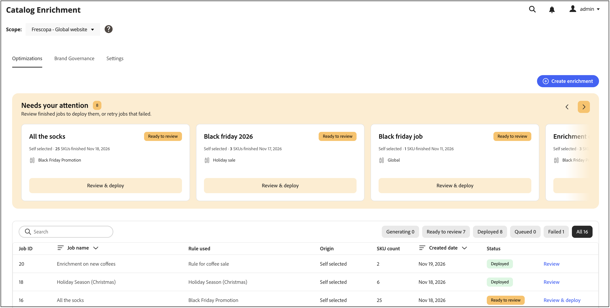

# カタログの強化

カタログのエンリッチメントは[!DNL Adobe Commerce]機能で、商品名と長い説明を改善することで、買い物客が商品調査や発見にLLMやAI アシスタントを使用する際に、カタログをより正確に表現できるようになります。

## 仕組み {#how-it-works}

[!DNL Adobe Commerce]製品カタログは、製品データ（名前、説明、属性、価格設定、在庫）の記録システムです。 [!DNL Adobe Commerce]は、ライブカタログデータをAdobe AI エクスペリエンスに接続します。 さらに、カタログエージェントは、製品名と長い説明のギャップを特定して改善を提案し、承認済みの変更をCommerceに書き戻して、Commerce管理者でレビューできるようにします。

カタログを強化することで、次のことが可能になります。

- LLMによる製品解釈に影響を与える、製品名と長い説明文のギャップや不整合を特定します。
- ジャスティフィケーションや前後の比較など、提案された改善をサポートコンテキストと共に確認できます。
- 承認済みの更新をCommerceカタログに直接適用することで、管理者やストアフロントなど、フィールドを読み取るチャネルの連携を維持できます。

Commerceには商品名と長い説明が保存されているため、一度編集したコピーを改善することは、商品データを利用するあらゆるチャネルにメリットをもたらします。 このメリットは、システムの更新方法と更新時期によって異なります。

| 方向 | 目的 |
| --- | --- |
| Commerce カタログ ->解析 | カタログとエージェント型のトラフィックシグナルにより、エンリッチメントの提案の機会が明らかになります。 |
| エンリッチメント -> Commerce カタログ | 更新を承認すると、製品名と説明の変更がCommerce カタログに保存され、管理者とストアフロントに最適化された値が反映されます。 |

### カタログの強化にアクセス

開始する前に、デプロイメント固有の[AI製品検出の前提条件](prerequisites.md)を確認してください。 Commerce プラットフォームの設定が完了したら、Adminで&#x200B;**[!UICONTROL AI Product Discovery]** > **[!UICONTROL Catalog Enrichment]**&#x200B;に移動します。

{zoomable="yes"}

カタログ強化ワークスペースには、**[!UICONTROL Optimizations]**、**[!UICONTROL Brand governance]**、**[!UICONTROL Settings]**&#x200B;のタブが含まれています。

- 「**[!UICONTROL Optimizations]**」タブを使用して、エージェンティックトラフィックベースの検出シグナルを確認し、エンリッチメントジョブを管理します。
- [!DNL Commerce Catalog Agent]によって生成された製品名と説明については、**[!UICONTROL Brand Governance]** タブを使用して[要件を定義](brand-governance.md)します。
- 「**[!UICONTROL Settings]**」タブを使用して、Commerce インスタンスを[AI Product Discoveryに接続します](settings.md)。

また、共有された拡張機能により、構造化された製品ファクトをAI エージェントに公開するための個別のワークフローを備えたPDP エンリッチメントも可能になります。 [製品詳細ページの強化](pdp-enrichment.md)を参照してください。

## カタログ強化の2つのパス

カタログのエンリッチメントを受け取るには、次の2つのパスがあります。

- **エージェンティックトラフィック** – このタイプのエンリッチメントは、Commerce インスタンスを設定してから24 ～ 48時間後に自動的に開始され、**最適化** タブに結果が表示されます。
- **Enrichment Manager** – 販売者が&#x200B;**[!UICONTROL Create enrichment]** ボタンをクリックし、エンリッチするSKUを手動で選択すると、これらのエンリッチメントが設定されます。 [ エンリッチメントマネージャー](#create-an-enrichment-job)の詳細をご覧ください。

### カタログ強化のレビューと適用 {#review-and-apply}

カタログのエンリッチメントを有効にして設定したら、**[!UICONTROL Optimizations]** タブを使用して、検索とエージェント型のトラフィックインサイトを確認し、エンリッチメントジョブを管理します。

### 月間エージェント型トラフィックの確認

毎月実施されるエージェント型トラフィック監査では、トラフィックの多いSKUを特定し、推奨されるバッチを利用できるようにします。 レビュー用の最適化は、エージェント型トラフィックの多いSKUに対して自動的に生成されます。 これらの最適化は、「デフォルト」のガバナンスルールに基づいて自動生成されます。 毎月のカードには、製品数、AI エージェントの訪問、雇用状況が表示されます。 エージェント型トラフィックと自己選択型バッチでは、同じルール選択、確認、実行、レビュー、デプロイワークフローを使用します。

### 注意が必要な作業の確認

**[!UICONTROL Needs your attention]** セクションでは、レビューの準備が完了したジョブなど、アクションが必要なジョブを強調表示します。 完了したジョブを開いて、デプロイメントの前に提案された製品の変更を確認します。

### ジョブの検索

**[!UICONTROL All jobs]** テーブルには、各ジョブ ID、名前、オリジン、SKU数、使用されるルール、開始時間、およびステータスが一覧表示されます。 オリジン バッチが自己選択されたか、エージェント型トラフィックから推奨されたかを識別します。 処理ステータスを&#x200B;**[!UICONTROL Queued]**、**[!UICONTROL Running]**、**[!UICONTROL Completed]**&#x200B;または&#x200B;**[!UICONTROL Failed]**&#x200B;として追跡します。 最適化ワークスペースでは、これらのジョブは、実行中に&#x200B;**[!UICONTROL Generating]**、生成が完了したときに&#x200B;**[!UICONTROL Ready to review]**、承認済みの変更がデプロイされた後に&#x200B;**[!UICONTROL Deployed]**&#x200B;と表示されることもあります。 複数のジョブを同時に実行できます。 失敗したジョブを&#x200B;**[!UICONTROL Retry]**&#x200B;で再試行してください。

### エンリッチメントジョブの作成

**カタログのエンリッチメントを作成するには：**

{zoomable="yes"}

1. **[!UICONTROL Optimizations]**&#x200B;で、**[!UICONTROL Create enrichment]**&#x200B;をクリックします。
1. 「Black Friday 2026」など、**エンリッチメント名**&#x200B;を入力します。
1. 「コーヒー」など、**カテゴリ**&#x200B;を選択します。
1. 「アクセサリ」など、**属性セット**&#x200B;を選択します。
1. 「シンプルな製品」など、**製品タイプ**&#x200B;を選択します。
1. **価格帯**&#x200B;を選択します。
1. **[!UICONTROL Apply filters]**&#x200B;をクリックします。

   エンリッチメント条件に一致する製品をプレビューし、**カスタマイズ**&#x200B;をクリックして、エンリッチメントする製品をさらに範囲で表示できます。

1. **[!DNL Next]**&#x200B;をクリックし、エンリッチメントに適用されている[ ガバナンスルール ](brand-governance.md)をプレビューします。
1. エンリッチする特定の製品を確認するには、**[!DNL Next]**&#x200B;をクリックします。
1. **[!DNL Run enrichment]**&#x200B;をクリックします。

   エンリッチメントジョブが実行され、最適化テーブルに表示されます。 実行が完了したら、最適化を[ レビューして](#review-deploy-catalog) デプロイできます。

### エンリッチメントジョブのレビューとデプロイ {#review-deploy-catalog}

エンリッチメントジョブを開きます。

{zoomable="yes"}

候補&#x200B;**付き** URL テーブルには、エンリッチメントの機会を持つすべての製品が一覧表示されます。 各製品について、次のことができます。

- **AI分析と提案されたエンリッチメントを表示するには、行**&#x200B;を展開します。
- **ブランドボイスとマーチャンダイジングガイドラインに合わせて、提案された製品名または説明を適用前に**&#x200B;編集します。
- **エンリッチメントする商品のOptimization**&#x200B;をデプロイし、Adobe Commerce カタログに直接公開します。
- エンリッチメントがレビューおよび適用されたら、**修正済みとしてマーク**&#x200B;します。
- カタログ戦略に関連しない提案を&#x200B;**無視**&#x200B;します。

提案は、**現在の提案**、**修正提案**、**無視された提案**&#x200B;の3つのビューに整理されます。 エンリッチメントが適用されると、ステータスが&#x200B;**Applied**&#x200B;で&#x200B;**View in Catalog** アクションのFixed Suggestionsに移動し、Adobe Commerceで更新を確認します。 適用されたエンリッチメントはいつでもロールバックでき、元の製品名と説明を復元できます。

## 管理者でのエンリッチメントの確認 {#verify-in-admin}

**適用されたカタログの強化を確認するには：**

1. Commerce Adminで&#x200B;**[!UICONTROL Catalog]** > **[!UICONTROL Products]**&#x200B;に移動します。
1. 必要に応じて、フィルターと&#x200B;**[!UICONTROL Store View]** セレクターを使用します（例：**[!UICONTROL Default Store View]**）。
1. SKUを検索します。
1. 製品を編集モードで開きます。

   製品フォームには、強化された製品名や説明が表示されます。

   {zoomable="yes"}を強化しました

1. オプション：代わりに手動で入力した名前を保持する場合は、**[!UICONTROL Override Catalog Agent provided Product Name]**&#x200B;を選択します。

   手動での上書きは、提案がカタログとの同期を維持する方法に影響します。 詳しくは、[管理者](#manual-override-in-the-admin)での手動による上書きを参照してください。

1. 「**[!UICONTROL Content]**」セクションを展開し、説明フィールドを見つけます。

   説明の変更を適用すると、強化された説明が表示されます。

   {zoomable="yes"}を拡充

1. オプション：代わりに手動で入力した説明を保持する場合は、**[!UICONTROL Override Catalog Agent provided Description]**&#x200B;を選択します。

手動での上書きは、提案がカタログとの同期を維持する方法に影響します。 詳しくは、[管理者](#manual-override-in-the-admin)での手動による上書きを参照してください。

## ストアフロントでエンリッチメントを確認する {#verify-storefront}

**ストアフロントでエンリッチメントを検証するには：**

1. ストアフロントでSKUを検索します。
1. 製品ページを開きます。
1. 製品名と説明が承認済みの内容と一致することを確認します。

   ストアフロントにエンリッチメントが表示されるまでに時間がかかる場合があります。

1. 長い説明を表示する地域が、承認済みの地域と一致することを確認します。
1. オプション：ロールアウトに関連する場合は、同じカタログ属性を使用するダウンストリームチャネルを確認します。

## 上書き、取り込み、古い提案 {#overrides-ingestion}

カタログのエンリッチメントにより、製品の名前や説明が更新されると、他の取り込みシステムが同じフィールドを変更する場合があります。 REST API呼び出し、CSV読み込み、PIM フィードなどの例があります。

### オリジナルの値を再取得 {#original-value-reingested}

外部プロセスが元の名前または説明（エンリッチメントが適用される前に存在していた値）を書き込んだ場合、Commerceは、カタログ エンリッチメントルールに従って、そのフィールドのエンリッチメント値を引き続き尊重します。 提案は、その取り込みだけでは自動的に元に戻らない場合があります。

### 新しい値が再び取り込まれました {#new-value-reingested}

外部プロセスがプリエンリッチメントテキストの繰り返しではない新しい値を送信する場合、Commerceは新しいカタログ値を尊重します。 例えば、「赤い靴」から「象徴的な赤い靴」に名前を変更すると、エンリッチメントされた値に置き換わります。 ライブカタログが提案コンテキストと一致しなくなったため、関連するエンリッチメントの提案は、通常、*古い*&#x200B;とマークされます。

### 管理者の手動オーバーライド {#manual-override-in-the-admin}

[!DNL Adobe Commerce]管理者で製品名または説明を手動で編集する場合：

- Adminの値は、その手動変更の記録システムとして勝ちます。
- エンリッチメントの提案は、*古い*&#x200B;とマークされています。
- 提案ワークフローは、その項目の元の状態に戻るので、分析が再度実行された場合は、ベースラインを変更したり、新しい提案を受け入れたりできます。

これらのルールは、複数のチャネルが同じSKUに接触した場合に、カタログのエンリッチメント、取り込みフィード、管理者編集のいずれが権限を持つかを判断するのに役立ちます。

## 制限と考慮事項 {#limits}

- エンリッチメントは、商品名と長い説明文にのみ適用されます。 商品詳細ページレイアウト、ウィジェット、その他のページレベルのストアフロントコンテンツは変更されません。
- 大きなカタログとURL数が多い場合、分析の完了速度と一度に表示される候補の数に影響を与える可能性があります。
- 有意義な提案は、LLM関連ボットが気になる製品URLにアクセスできることを前提としています。 ロボットルール、認証、ジオブロッキング、高度なパーソナライゼーションにより、カバー範囲を縮小することができます。

## ベストプラクティス {#best-practices}

- PIMまたはフィードのジョブが意図せずカタログのエンリッチメントと競合しないように、製品名と説明のシステム所有権を文書化します。
- タイトルや説明を一括適用する前に、SEO チームやブランドチームと調整しましょう。
- 主要なカタログのインポート後に再同期または再分析して、現在のカタログの状態を提案に反映します。

## 例

次の例は、カタログのエンリッチメントにより、生の技術属性を、買い物客に焦点を当てた物語のような製品コピーに変換する方法を示しています。

### 例：技術的な属性を含むコーヒー製品

コーヒーretailerのカタログには、コーヒー豆の品種、原産地、加工方法、焙煎レベル、標高範囲などの中程度のコーヒー豆商品の技術仕様のみが保存されています。 これらのフィールドは商品を説明するものの、買い物客にその価値を伝えないため、AI アシスタントは「スムーズで低酸の味がするコーヒーは何ですか？」などの質問に答える際に、ほとんど操作できません。

カタログのエンリッチメントでは、技術的な属性と理由を読み取り、買い物客に関連する特性を推測します。

| 技術的属性 | 推測特性 | 推論 |
| --- | --- | --- |
| ハニープロセス、Mediumロースト | 低酸度 | 蜂蜜の処理中に豆に残った果実ムシラージュは酸性度を抑制し、中焙煎は残留酸性化合物を分解します。 |
| ハニープロセス，アラビカ，Mediumロースト | ヘーゼルナッツ味 | ムシラージュの果糖は、アラビカの天然ナッツノートと組み合わされ、中程度のローストで増幅されます。 |
| ハニープロセス，アラビカ | リッチでクリーミーな食感 | 乾燥中に粘液から吸収された油は粘度と体を追加します。 |
| 蜂蜜プロセス、高度900-1200m | キャラメルのアンダートーン | より密度の高い高地の豆は、蜂蜜の処理によって深められた、より複雑な糖を開発します。 |

カタログの強化では、推測された特性を商品コピーに適用します。

- **前**:「Mediumローストコーヒー豆 – アラビカ、ブラジルミナスジェライス、ハニープロセス、900～1200m」
- **After**:「ブラジルのミナスジェライスで900～1200mで栽培されたアラビカ豆は、ハチミツ加工でミディアムローストし、独特のヘーゼルナッツの個性、キャラメルの下調、低い酸味を備えた、自然に甘くクリーミーな食感を生み出します。 連続した、親しみやすいスペシャルティコーヒーは、注ぎ込むのを通して最高の経験しました。」

更新された名前と説明はCommerceカタログに直接保存されるため、ストアフロント、LLM フィード、それらのフィールドを読み取るその他のチャネルには、同じエンリッチメントコピーが反映されます。

### 例：モジュール式の家具構成

Furniture retailerでは、モジュール式のセクショナルソファが販売されています。このソファでは、製品説明にコンフィギュレーションコードとファブリック名（例：`6 Standard Seats + 6 Standard Sides in Sapphire Navy Corded Velvet`）のみが記載されています。 この略語は、リピート顧客には理解できますが、AI アシスタントは、商品がどのように機能するのか、何が耐久性や快適なものなのかについてのコンテキストをほとんど提供しません。

カタログのエンリッチメントにより、設定とファブリックの属性がナラティブな説明に展開され、各コンポーネントの機能と、買い物客にとって重要な理由が説明されます。

- **前**:「サファイア海軍コードベルベットの標準座席数6席+標準座席数6面」
- **After**: 「この設定には、6つの標準シート挿入セットと6つの標準サイドインサートが含まれており、アームまたはバックとして互換性を持って機能し、レイアウトのモジュール式ビルディングブロックを形成します。 各シートは、リフトを保持し、たるみを防ぐために設計された3つの高密度レイヤーを備えた標準フォームを備えています。 サファイア海軍コード付きベルベットカバーは、繊細な光沢と柔らかく豪華な雰囲気を作り出すテクスチャコードを備えた豪華な耐久性があります。 カバーは正確でカスタマイズされた外観を実現するために手縫いされており、機械で洗って変更できるため、セクションはスペースとともに進化することができます。」

強化された説明はCommerce カタログに書き戻されるので、AI ボットは商品詳細ページをクロールして、商品のカタログデータを使用するダウンストリームチャネルやフィードにも使用できます。買い物客がページに表示するレイアウトやデザインは変更されません。
