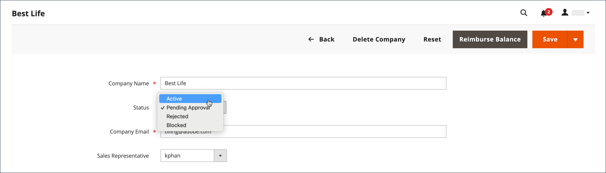

# 会社アカウントを承認

会社を作成するためにストアフロントから受け取ったリクエストのステータスは、ストア管理者がリクエストを確認し、承認または拒否されるまで`Pending Approval`です。 会社アカウントのステータスは、次のいずれかに設定できます。

- [!UICONTROL Active]
- [!UICONTROL Pending Approval]
- [!UICONTROL Rejected]
- [!UICONTROL Blocked]

[ アクション コントロール ](account-company-manage.md)を使用して、複数の会社リクエストを承認することもできます。

{width="700" zoomable="yes"}

## 会社の保留中のアカウントを承認

1. _管理者_ サイドバーで、**[!UICONTROL Customers]** > **[!UICONTROL Companies]**&#x200B;に移動します。

   グリッドの上にある&#x200B;_[!UICONTROL Columns]_セレクターを使用して、**[!UICONTROL Status]**列を表示できます。

1. _[!UICONTROL Action]_列で、**[!UICONTROL Edit]**をクリックします。

1. **[!UICONTROL Company Status]**&#x200B;を`Active`に設定します。

   {width="700" zoomable="yes"}

1. 確認を求められたら、**[!UICONTROL Change status]**&#x200B;をクリックします。

   会社の管理者は、会社がアクティブになったというメール通知を受け取ります。

1. 該当する場合は、**[!UICONTROL Sales Representative]**&#x200B;を特定の管理者ユーザーアカウントに設定します。

1. **[!UICONTROL Account Information]** セクションのを展開し、**[!UICONTROL Comment]** フィールドを使用してアカウントに関するメモを入力します。

   コメントはストアフロントからは表示されません。

1. 完了したら、**[!UICONTROL Save]**&#x200B;をクリックします。

   会社アカウントが承認されたことを確認するメールが、会社および会社の管理者に送信されます。

## 会社ステータス

| ステータス | 説明 |
|------------------|--------------------------------------------------------------------------------------------------------------------------------------------|
| [!UICONTROL Active] | 会社は承認され、会社の管理者がストアフロントから管理できます。 |
| [!UICONTROL Pending Approval] | 会社アカウントの作成リクエストがストアフロントから送信されましたが、まだレビューされていません。 |
| [!UICONTROL Rejected] | 会社アカウントを作成するリクエストは、ストア管理者によって拒否されました。 |
| [!UICONTROL Blocked] | 会社のアカウントはもはや良い状態ではありません。 顧客はストアフロントからアカウントにアクセスできますが、購入はできません。 |

{style="table-layout:auto"}
