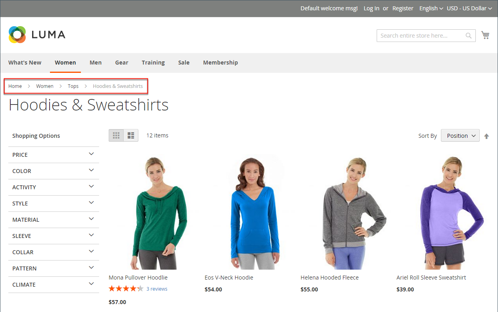
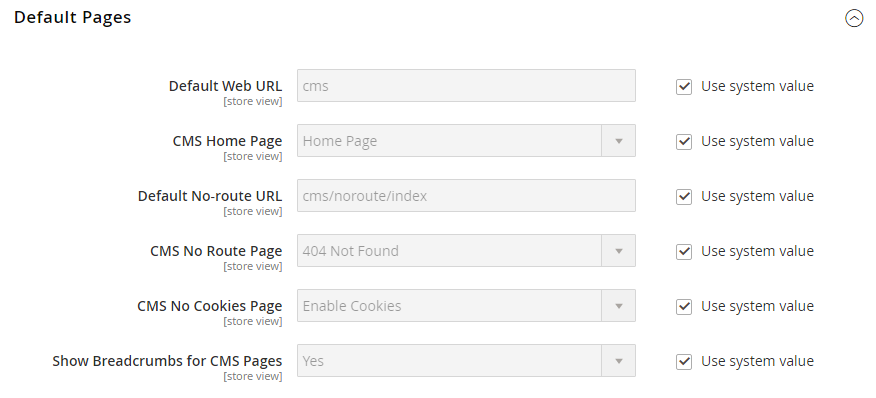

# パンくずリスト

_パンくずリスト_&#x200B;は、顧客がストア内の他のページに関連する位置を示す一連のリンクです。 パンくずリスト内の任意のリンクをクリックして、前のページに戻ることができます。

パンくずリストは、コンテンツページとカタログページに表示するように設定できます。 パンくずリストの形式と位置はテーマによって異なりますが、通常はヘッダーのすぐ下にあります。 デフォルトでは、パンくずリストはCMS ページに表示されます。

ストアフロントに表示された{width="700" zoomable="yes"}

## パンくずリストの一般的な種類

パンくずリストは、目的が異なる3つの主な種類に分けることができます。 各タイプのパンくずリストの実装の本質と主な原則は以下のとおりです。

### 階層ベースのパンくずリスト

この種類のパンくずリストは、サイトで設定されたカテゴリ階層に基づいています。 提示されたチェーンは、構造内のどこにあるかをユーザーに伝えます。 この場合、各テキストリンクは、前のページよりも1 レベル高いページを対象としています。

例：`Men > Tops > Hoodies & Sweatshirts`

このタイプの利点は、ユーザーが自分がどのカテゴリーレベルにあるかを簡単に確認でき、カタログページ間のナビゲーションに簡単にアクセスできることです。

### 履歴ベースのパンくずリスト

履歴（またはパス）ベースのナビゲーションは、ブラウザーの「戻る」ボタンに似ています。 このタイプのナビゲーションでは、ユーザーは変更することなく、以前に訪問したページにすばやく戻ることができます。

このタイプの利点は、顧客がカテゴリーページで複数のフィルターを選択した後に前のページに戻りたい場合に最も役立つことです。

例：`Home > What's New > Gear > Bags`

### 属性ベースのパンくずリスト

このタイプのパンくずリストには、カテゴリーページで選択した属性が表示されます。 他のタイプとの主な違いは、属性ベースのパンくずリストは、顧客が特定の製品（価格、品質、色など）のナビゲーションレイヤーで選択したフィルターとオプションを表していることです。

例：`Home > Suits > All Suits > Refined by > Slim Fit`

## CMS ページからパンくずリストを追加または削除する

1. _管理者_ サイドバーで、**[!UICONTROL Stores]** > _[!UICONTROL Settings]_>**[!UICONTROL Configuration]**に移動します。

1. _[!UICONTROL General]_の下の左側のパネルで、**[!UICONTROL Web]**を選択します。

   {width="600" zoomable="yes"}

1. _[!UICONTROL Default Pages]_セクションを展開します。

1. 「**[!UICONTROL Use system value]**」チェックボックスの選択を解除します。

1. **[!UICONTROL Show Breadcrumbs for CMS Pages]**&#x200B;を`No`または`Yes`に設定します。

1. 完了したら、**[!UICONTROL Save Config]**&#x200B;をクリックします。

>[!NOTE]
>
>親カテゴリは、`Browsing Category`= `Deny` [ カテゴリ権限](category-permissions.md)の設定がある場合、子カテゴリページのパンくずリストには表示されません。
