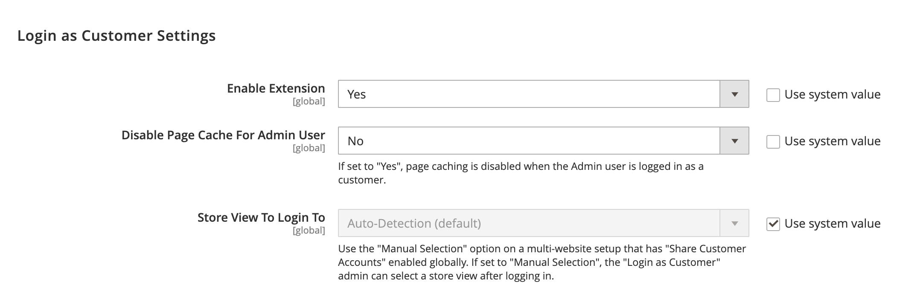

# [!UICONTROL Customers] > [!UICONTROL Login As Customer]

{{config}}

## 一般オプション

<!-- zoom -->

<!-- [Login As Customer - General Options](https://experienceleague.adobe.com/en/docs/commerce-admin/customers/customer-accounts/manage/login-as-customer) -->

| オプション | [範囲](../../getting-started/websites-stores-views.md#scope-settings) | 説明 |
|-- | -- | -- |
| [!UICONTROL Enable Login as Customer] | グローバル | _お客様としてログイン_&#x200B;がグローバル スコープで有効になっているかどうかを確認します。 オプション：`Yes` / `No` |
| [!UICONTROL Disable Page Cache for Admin User] | グローバル | 管理者ユーザーのページキャッシュがグローバルスコープで無効になっているかどうかを指定します。 オプション：`Yes` / `No` |
| [!UICONTROL Store View to Log in] | グローバル | `Auto-Detection (default)`は、その会社ユーザーの既定のストア設定を使用します。 _管理者_ ユーザーが顧客としてログインするときにストアビューを選択する場合は、`Manual Selection`を使用します。 |
| [!UICONTROL Title for Login as Customer opt-in checkbox] | web サイト | `Login as customer` チェックボックスのタイトルを追加します。 |
| [!UICONTROL Login as Customer checkbox tooltip] | web サイト | `Log in as customer` チェックボックスのツールヒントを追加します。 |

{style="table-layout:auto"}
