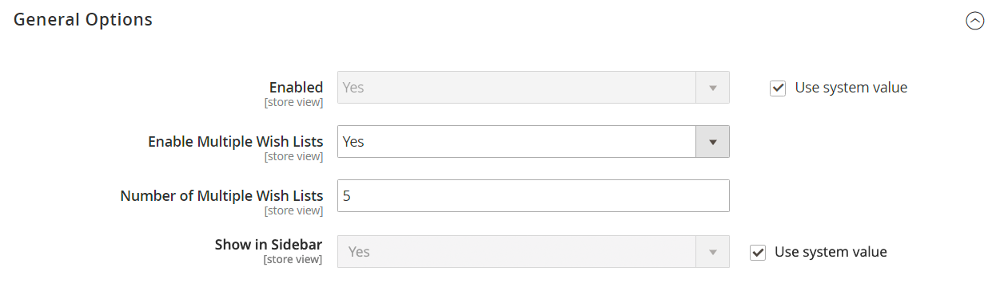
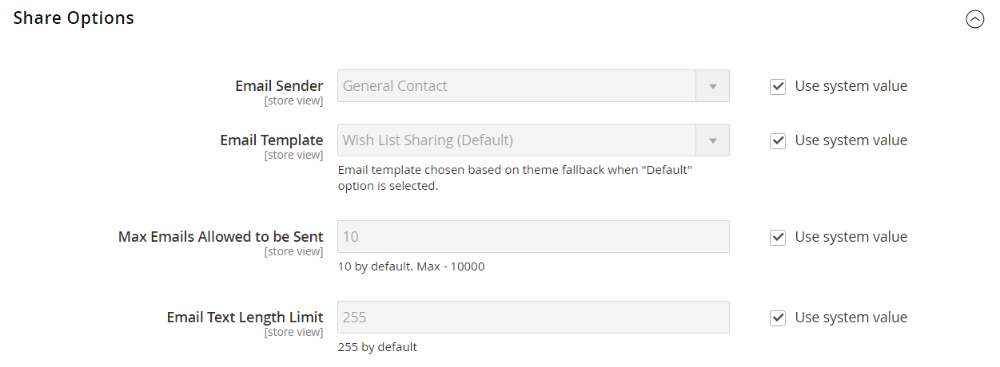
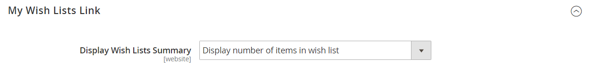

# [!UICONTROL Customers] > [!UICONTROL Wish List]

{{config}}

>[!NOTE]
>
>ウィッシュリストでは、登録した顧客が将来購入したい商品の独自のコレクションを作成できます。 ウィッシュリストは顧客間で共有できます。

## [!UICONTROL General Options]

<!-- zoom -->

<!--[General Options](https://experienceleague.adobe.com/en/docs/commerce-admin/stores-sales/shopper-tools/wish-lists/wishlist-configuration) -->

| フィールド | [範囲](../../getting-started/websites-stores-views.md#scope-settings) | 説明 |
|--- |--- |--- |
| [!UICONTROL Enabled] | ストアビュー | ストアのウィッシュリストモジュールをアクティブ化します。 オプション：`Yes` / `No` |
| [!UICONTROL Show in Sidebar] | ストアビュー | サイドバーでのウィッシュリストの表示を指定します。   オプション：`Yes` / `No` |
| [!UICONTROL Enable Multiple Wish Lists] | ストアビュー |  （Adobe Commerceのみ）を`Yes`に設定すると、お客様は複数のウィッシュリストを作成および管理できます。 オプション：`Yes` / `No` |
| [!UICONTROL Number of Multiple Wish Lists] | ストアビュー |  （Adobe Commerceのみ）複数のウィッシュリストが有効になっている場合は、お客様がアカウントに関連付けることができるウィッシュリストの最大数を決定します。 |

{style="table-layout:auto"}

## [!UICONTROL Share Options]

<!-- zoom -->

<!-- [Share Options](https://experienceleague.adobe.com/en/docs/commerce-admin/stores-sales/shopper-tools/wish-lists/wishlist-configuration) -->

| フィールド | [範囲](../../getting-started/websites-stores-views.md#scope-settings) | 説明 |
|--- |--- |--- |
| [!UICONTROL Email Sender] | ストアビュー | ウィッシュリストの共有時に送信されるメッセージの送信者として表示されるストア連絡先を指定します。 既定の連絡先：`General Contact` |
| [!UICONTROL Email Template] | ストアビュー | 欲しいものリストを共有するときに送信されるメッセージに使用される電子メールテンプレートを決定します。 既定のテンプレート：`Share Wishlist` |
| [!UICONTROL Max Emails Allowed to be Sent] | ストアビュー | バッチで送信できるメールの最大数を指定します。 最大制限を設定すると、サーバーの負荷を軽減できます。 許可される最大数は10,000です。 デフォルト値：`10` |
| [!UICONTROL Email Text Length Limit] | ストアビュー | メッセージに含めることができる最大文字数を指定します。 許可される最大数は10,000です。 デフォルト値：`255` |

{style="table-layout:auto"}

## [!UICONTROL My Wish List Link]

<!-- zoom -->

<!--[My Wish List Link](https://experienceleague.adobe.com/en/docs/commerce-admin/stores-sales/shopper-tools/wish-lists/wishlist-configuration) -->

| フィールド | [範囲](../../getting-started/websites-stores-views.md#scope-settings) | 説明 |
|--- |--- |--- |
| [!UICONTROL Display Wish List Summary] | web サイト | 顧客アカウントダッシュボードでのウィッシュリストの概要の表示を設定します。 オプション：`Display number of items in wish list` / `Display item quantities` |

{style="table-layout:auto"}
