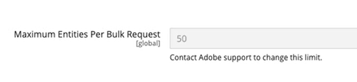

# [!UICONTROL General] > [!UICONTROL Bulk API]

{{config}}

## [!UICONTROL General]

<!-- zoom -->

| フィールド | [範囲](../../getting-started/websites-stores-views.md#scope-settings) | 説明 |
|--- |--- |--- |
| [!UICONTROL Maximum Entities Per Bulk Request] | グローバル | 1回の一括要求で処理できるエンティティの最大数を表示します。 [Bulk API](https://developer.adobe.com/commerce/webapi/rest/use-rest/bulk-endpoints/){target="_blank"}は、複数の呼び出しを1つのリクエストに組み合わせて、リクエスト数を減らし、パフォーマンスを向上させることをお勧めします。 お客様は、[Adobe Commerce サポート &#x200B;](https://experienceleague.adobe.com/en/support?support-tab=home#support)に連絡して、[!UICONTROL Maximum Entities Per Bulk Request]の増額をリクエストできます。 Adobeがユースケースをレビューし、一括リクエストサイズを増やすことが適切かどうかを判断します。 |

{style="table-layout:auto"}
