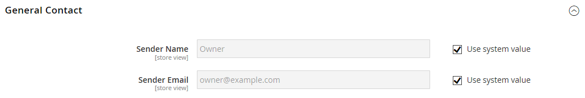
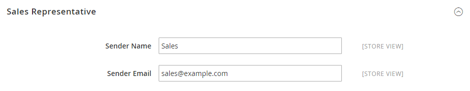

# [!UICONTROL General] > [!UICONTROL Store Email Addresses]

{{config}}

これらの設定フィールドとオプションについて詳しくは、[ メールアドレスを保存](../../getting-started/store-details.md#store-email-addresses)を参照してください。

## [!UICONTROL General]

[!BADGE SaaSのみ]{type=Positive url="https://experienceleague.adobe.com/en/docs/commerce/user-guides/product-solutions" tooltip="Adobe Commerce as a Cloud Service プロジェクト（Adobeで管理されるSaaS インフラストラクチャ）にのみ適用されます。"}

<!-- zoom -->

| フィールド | [範囲](../../getting-started/websites-stores-views.md#scope-settings) | 説明 |
|--- |--- |--- |
| [!UICONTROL Storefront Base URL] | ストアビュー | 顧客向けメールに含まれるリンクの作成に使用されるベース URL。 URLはスラッシュで終わる必要があります。 例：`https://www.example.com/`。 |

{style="table-layout:auto"}

## [!UICONTROL General Contact]

<!-- zoom -->

| フィールド | [範囲](../../getting-started/websites-stores-views.md#scope-settings) | 説明 |
|--- |--- |--- |
| [!UICONTROL Sender Name] | ストアビュー | `General Contact` IDによって送信されたメールの送信者として表示される名前。 |
| [!UICONTROL Sender Email] | ストアビュー | `General Contact` IDに関連付けられている電子メールアドレス。 Adobe Commerce as a Cloud Serviceで、サポートチケットを作成してメールアドレスを変更します。 |

{style="table-layout:auto"}

## [!UICONTROL Sales Representative]

<!-- zoom -->

| フィールド | [範囲](../../getting-started/websites-stores-views.md#scope-settings) | 説明 |
|--- |--- |--- |
| [!UICONTROL Sender Name] | ストアビュー | `Sales Representative` IDによって送信されたメールの送信者として表示される名前。 |
| [!UICONTROL Sender Email] | ストアビュー | `Sales Representative` IDに関連付けられている電子メールアドレス。  Adobe Commerce as a Cloud Serviceで、サポートチケットを作成してメールアドレスを変更します。 |

{style="table-layout:auto"}

## [!UICONTROL Customer Support]

<!-- zoom -->

| フィールド | [範囲](../../getting-started/websites-stores-views.md#scope-settings) | 説明 |
|--- |--- |--- |
| [!UICONTROL Sender Name] | ストアビュー | `Customer Support` IDによって送信されたメールの送信者として表示される名前。 |
| [!UICONTROL Sender Email] | ストアビュー | `Customer Support` IDに関連付けられている電子メールアドレス。  Adobe Commerce as a Cloud Serviceで、サポートチケットを作成してメールアドレスを変更します。 |

{style="table-layout:auto"}

## カスタムメール 1

<!-- zoom -->

| フィールド | [範囲](../../getting-started/websites-stores-views.md#scope-settings) | 説明 |
|--- |--- |--- |
| [!UICONTROL Sender Name] | ストアビュー | `Custom 1` IDによって送信されたメールの送信者として表示される名前。 |
| [!UICONTROL Sender Email] | ストアビュー | `Custom 1` IDに関連付けられている電子メールアドレス。  Adobe Commerce as a Cloud Serviceで、サポートチケットを作成してメールアドレスを変更します。 |

{style="table-layout:auto"}

## カスタムメール 2

<!-- zoom -->

| フィールド | [範囲](../../getting-started/websites-stores-views.md#scope-settings) | 説明 |
|--- |--- |--- |
| [!UICONTROL Sender Name] | ストアビュー | `Custom 2` IDによって送信されたメールの送信者として表示される名前。 |
| [!UICONTROL Sender Email] | ストアビュー | `Custom 2` IDに関連付けられている電子メールアドレス。  Adobe Commerce as a Cloud Serviceで、サポートチケットを作成してメールアドレスを変更します。 |

{style="table-layout:auto"}
