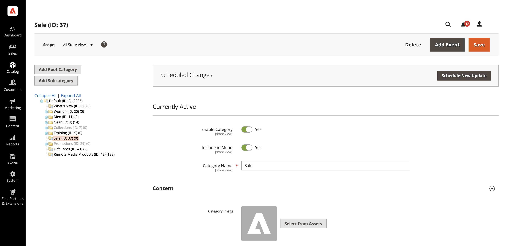

# AEM Assetsの使用

<!--In ACAP-844, this topic was linked to from the Commerce Admin products images and videos when the Assets integration is enabled. If the URL to the topic changes, be sure to add a redirect.-->

## アセットの更新

AEM Assetsでアセットを編集した後、アセットを承認して再処理することで、更新をCommerceに送信します。 承認済みのアセットのみがCommerce インスタンスに送信されます。 アセットを再処理することで、アセットがAdobe Commerceに送信される前に、最終的な変更やメタデータの更新が確実に取得されます。

詳しくは、次のAEM Assets ドキュメントを参照してください。

- [デジタルアセットの再処理](https://experienceleague.adobe.com/en/docs/experience-manager-cloud-service/content/assets/manage/reprocessing)

- [アセットの承認](https://experienceleague.adobe.com/en/docs/experience-manager-cloud-service/content/assets/dynamicmedia/dynamic-media-open-apis/approve-assets)

## カテゴリへのアセットの追加コンテンツ

AEM Assets統合を有効にして設定すると、アセットをカタログカテゴリのコンテンツに追加できます。

1. _管理者_ サイドバーで、**[!UICONTROL Catalog]** > **[!UICONTROL Categories]**&#x200B;に移動します。

1. **[!UICONTROL Content]** セクションのを展開します。

   {width="600" zoomable="yes"}

1. ページの上部に&#x200B;**[!UICONTROL Category Image]**&#x200B;を表示するには、**[!UICONTROL Select from Assets]**&#x200B;をクリックして、AEM Assets フォルダーの画像を使用します。

1. **[!UICONTROL Save]**&#x200B;をクリックして続行します。

   カテゴリを作成する方法の詳細については、[ カテゴリのコンテンツを完了](../catalog/category-create.md#step-3-complete-the-category-content)するを参照してください。

