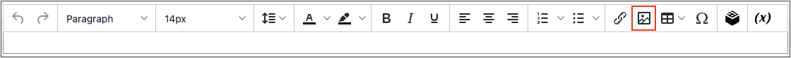
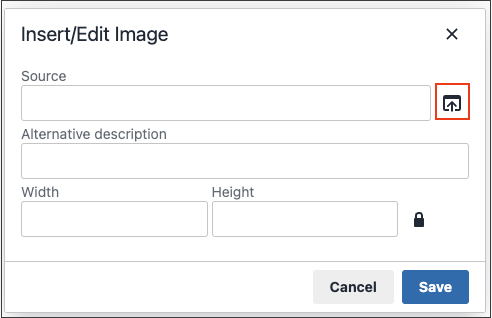
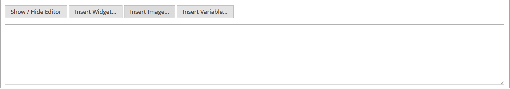

# メディアストレージ

メディアストレージは、サーバーに保存されているメディアファイルを整理し、アクセスできるようにします。 ファイルの場所へのパスは、[ ベース URL](../stores-purchase/store-urls.md)設定によって決まります。 メディアストレージ内のファイルは、ページと静的ブロックの作業中にエディターからアクセスできます。 通常、メディアストレージは、[!DNL Commerce] プログラムファイルと同じサーバー上のファイルシステムにあります。

または、メディアファイルは[ データベース ](media-storage-database.md)または別のサーバーまたは[ コンテンツ配信ネットワーク ](media-storage-content-delivery-network.md)で管理できます。 代替ストレージを使用する利点は、メディアの同期に必要な労力を最小限に抑えることです。 同期パフォーマンスは、同じ画像、CSS ファイル、その他のメディアファイルにアクセスする必要がある異なるサーバーにシステムの複数のインスタンスがデプロイされた場合に特に影響を受けます。

エディターは、カテゴリまたは製品説明のカタログコンテンツに静的または[動的メディア URL](../catalog/catalog-urls.md#configure-catalog-media-url-format)を使用するように設定できます。

![[!DNL Commerce] メディアストレージ ](./assets/media-storage.png){width="650" zoomable="yes"}

## メディアストレージへのファイルの追加

最初の2つの手順は、画像を挿入する場合と同じです。

1. [ エディター](editor.md) ツールバーで、_画像を挿入_ アイコンをクリックします。

   {width="700" zoomable="yes"}

   このアクションにより、_[!UICONTROL Insert/edit image]_ダイアログが開きます。

1. _[!UICONTROL Source]_の後、_&#x200B;検索&#x200B;_アイコン （{width="10" zoomable="no"}）をクリックします。

1. 左側のディレクトリツリーで、次のいずれかの操作を行います。

   - アップロードした画像を保存するフォルダーに移動します。

   - フォルダーを作成する場所に移動し、**フォルダーを作成**&#x200B;をクリックします。

     フォルダーを追加するには、フォルダー名を入力し、**[!UICONTROL OK]**&#x200B;をクリックします。

1. 1つ以上のファイルをMedia Storageに追加するには、システムからファイルをアップロードするか、[Adobe Stock統合](adobe-stock.md)を使用します。

   システムからファイルをアップロードするには、**[!UICONTROL Choose Files]**&#x200B;をクリックし、次の操作を行います。

   - ローカルコンピューターのディレクトリで、画像の場所に移動します。

   - アップロードする各画像を選択します。

   - **[!UICONTROL Open]**&#x200B;をクリックします。

   [統合](adobe-stock.md)を使用してAdobe Stockのアセットを使用するには：

   - **[!UICONTROL Search Adobe Stock]**&#x200B;をクリックします。

   - Adobe Stockからプレビューまたはライセンス済みの画像を追加します（[Adobe Stock画像の使用](adobe-stock-manage.md)を参照）。

画像は、サーバー上の現在のMedia Storage フォルダーにアップロードされます。

![[!DNL Commerce] メディアストレージ ](./assets/media-storage.png){width="650" zoomable="yes"}

## メディアストレージからの画像の挿入

編集するページまたはブロックを開きます。 次のいずれかの方法を使用して、メディアストレージから画像を挿入します。

### 方法1:WYSIWYGモード

1. [ エディター](editor.md) ツールバーで、_画像を挿入_ アイコンをクリックします。

1. _[!UICONTROL Source]_の後、_&#x200B;検索&#x200B;_アイコン （{width="10" zoomable="no"}）をクリックします。

   {width="250" zoomable="yes"}

1. 左側のディレクトリツリーで、画像が保存されているフォルダーに移動します。

1. 画像のタイルを選択し、**[!UICONTROL Add Selected]**&#x200B;をクリックします。

### 方法2:HTMLモード

1. `` タグを挿入するコード内にカーソルを置きます。

1. **[!UICONTROL Insert Image]**&#x200B;をクリックします。

   {width="600" zoomable="yes"}
