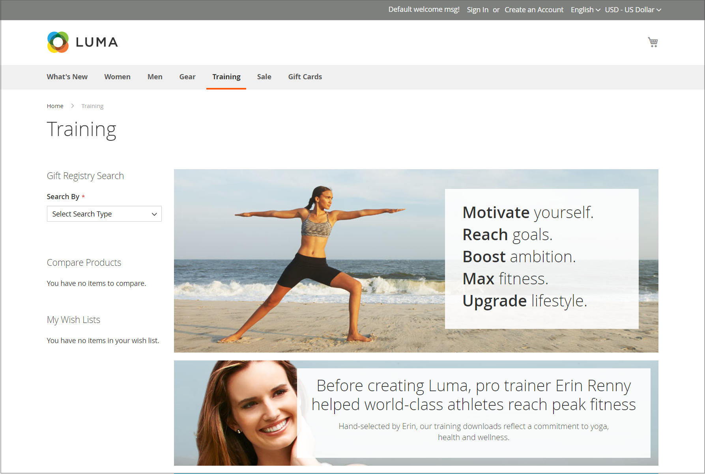
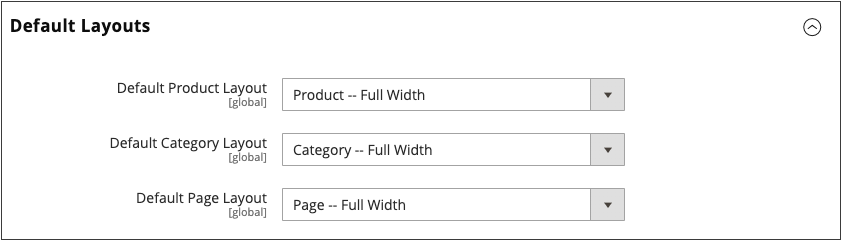
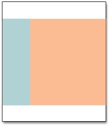
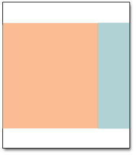
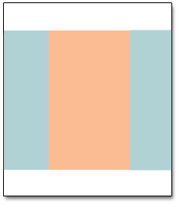

# ページレイアウト

ストア内の各ページのレイアウトは、ページのヘッダー、フッター、コンテンツ領域を定義する個別のセクション（コンテナ）で構成されます。 レイアウトによっては、各ページに1列、2列、3列またはそれ以上の列がある場合があります。 このレイアウトは、ページの&#x200B;_フロアプラン_&#x200B;と考え、CMS、商品、カテゴリーページのデフォルトとして使用する特定のレイアウトを割り当てることができます。

ページ上で、コンテンツブロックがフローティングされ、使用可能なスペースが埋められます。これは、表示するように割り当てられている[&#x200B; ページレイアウト &#x200B;](layout-updates.md)のセクションに従います。 レイアウトを3列から2列に変更すると、メインエリアの内容が拡張されて使用可能なスペースが埋まることに注意してください。 また、未使用のサイドバーに関連付けられているブロックが表示されなくなります。 ただし、3列レイアウトを復元すると、ブロックが再び表示されます。 この流動的なアプローチ（_リキッドレイアウト_）により、コンテンツを手直しすることなくページレイアウトを変更できます。 個々のHTML ページの操作に慣れている場合、このモジュール式の&#x200B;_ビルディングブロック_&#x200B;のアプローチでは、異なる考え方が必要です。

{width="700" zoomable="yes"}

## デフォルトレイアウトの設定

1. _管理者_ サイドバーで、**[!UICONTROL Stores]** > _[!UICONTROL Settings]_>**[!UICONTROL Configuration]**&#x200B;に移動します。

1. _[!UICONTROL General]_&#x200B;の下の左側のパネルで、**[!UICONTROL Web]**&#x200B;を選択します。

1. **[!UICONTROL Default Layouts]** セクションのを展開します。

   {width="600" zoomable="yes"}

1. 製品ページに使用する&#x200B;**[!UICONTROL Default Product Layout]**&#x200B;を選択します。

   この設定は、製品ページにデフォルトで使用されるレイアウトを決定します。

   - `No layout updates` – 製品ページのレイアウト更新は利用できません。
   - `Empty` – 商品ページに空白レイアウトを使用します。
   - `1 column` – 製品ページに単一の列レイアウトを使用します。
   - `2 columns with left bar` – 製品ページの左側にサイドバーがある2列レイアウトを使用します。
   - `2 columns with right bar` – 商品ページの右側にサイドバーがある2列レイアウトを使用します。
   - `3 columns` – 商品ページの左側と右側にサイドバーがある3列レイアウトを使用します。

   [&#x200B; ページビルダー](../page-builder/introduction.md)が有効になっている場合は、追加の全幅オプションを使用できます。 次に、ページビルダーのコンテンツツールを使用して、製品ページのレイアウトをデザインします。

   - `Page -- Full Width` – 商品ページに&#x200B;_ページ – 全幅_ レイアウトを使用します。
   - `Category -- Full Width` – 製品ページに&#x200B;_カテゴリ – フル幅_ レイアウトを使用します。
   - `Product -- Full Width` - （推奨）製品ページに&#x200B;_製品 – 全幅_ レイアウトを使用します。

1. カテゴリーページに使用する&#x200B;**[!UICONTROL Default Category Layout]**&#x200B;を選択します。

   この設定は、カテゴリーページにデフォルトで使用されるレイアウトを決定します。

   - `No layout updates` - カテゴリ ページのレイアウト更新は利用できません。
   - `Empty` - カテゴリーページに空白レイアウトを使用します。
   - `1 column` - カテゴリ ページに単一の列レイアウトを使用します。
   - `2 columns with left bar` - カテゴリーページの左側にサイドバーが表示されている2列レイアウトを使用します。
   - `2 columns with right bar` - カテゴリーページの右側にサイドバーがある2列レイアウトを使用します。
   - `3 columns` - カテゴリ ページの左側と右側にサイドバーがある3列レイアウトを使用します。

   [&#x200B; ページビルダー](../page-builder/introduction.md)が有効になっている場合は、追加の全幅オプションを使用できます。 次に、ページビルダーのコンテンツツールを使用して、カテゴリーページのレイアウトをデザインします。

   - `Page -- Full Width` - カテゴリーページに&#x200B;_ページ – 全幅_ レイアウトを使用します。
   - `Category -- Full Width` - （推奨）は、カテゴリーページに&#x200B;_カテゴリ – 全幅_ レイアウトを使用します。
   - `Product -- Full Width` - カテゴリーページに&#x200B;_製品 – 全幅_ レイアウトを使用します。

1. CMS ページに使用する&#x200B;**[!UICONTROL Default Page Layout]**&#x200B;を選択します。

   この設定は、CMS ページでデフォルトで使用されるレイアウトを決定します。

   - `No layout updates` - CMS ページのレイアウト更新は利用できません。
   - `Empty` - CMS ページに空白レイアウトを使用します。
   - `1 column` - CMS ページに1列レイアウトを使用します。
   - `2 columns with left bar` - CMS ページの左側にサイドバーがある2列レイアウトを使用します。
   - `2 columns with right bar` - CMS ページの右側のサイドバーに2列レイアウトを使用します。
   - `3 columns` - CMS ページの左側と右側にサイドバーがある3列レイアウトを使用します。

   [&#x200B; ページビルダー](../page-builder/introduction.md)が有効になっている場合は、追加の全幅オプションを使用できます。 次に、ページビルダーコンテンツツールを使用して、CMS ページのレイアウトをデザインします。

   - `Page -- Full Width` - （推奨）CMS ページに&#x200B;_Page - Full Width_ レイアウトを使用します。
   - `Category - Full Width` - CMS ページに&#x200B;_カテゴリ – 全幅_ レイアウトを使用します。
   - `Product - Full Width` - CMS ページに&#x200B;_Product - Full Width_ レイアウトを使用します。

1. 完了したら、**[!UICONTROL Save Config]**&#x200B;をクリックします。

## 標準ページレイアウト

### 1列

{zoomable="yes"}

_[!UICONTROL 1 Column]_&#x200B;レイアウトを使用すると、大きな画像または焦点を持つドラマチックなホームページを作成できます。 ランディングページだけでなく、テキスト、画像、動画が組み合わされているほかのページにも適しています。

### 左の棒グラフを持つ2つの列

{zoomable="yes"}

_[!UICONTROL 2 Columns with Left Bar]_&#x200B;レイアウトは、カタログや階層化されたナビゲーションを含む検索結果ページなど、左側にナビゲーションが表示されるページによく使用されます。 また、左側のサポートコンテンツの追加ナビゲーションやブロックが必要なホームページにも最適な選択肢です。

### 右側のバーを持つ2つの列

{zoomable="yes"}

_[!UICONTROL 2 Columns with Right Bar]_&#x200B;レイアウトでは、メインコンテンツ領域が目を引く画像やバナーに十分な大きさになります。 このレイアウトは、サポートコンテンツのブロックが右側にある製品ページにも頻繁に使用されます。

### 三段組

{zoomable="yes"}

_[!UICONTROL 3 Column]_&#x200B;レイアウトには、ページのメインテキストを表示するのに十分な幅の中央の列があり、両側に追加のナビゲーション用のスペースとサポートコンテンツのブロックがあります。

### Empty

{zoomable="yes"}

_[!UICONTROL Empty]_&#x200B;レイアウトを使用して、カスタムページレイアウトを定義できます。
