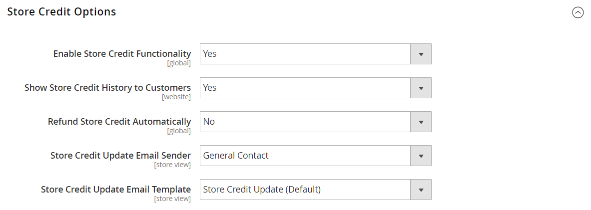

# ストアクレジットを設定

{{ee-feature}}

ストアクレジット設定では、自動払い戻し、顧客アカウント内の利用可能なクレジットの表示、顧客に送信される通知に使用されるメールテンプレートが制御されます。

1. _管理者_ サイドバーで、**[!UICONTROL Stores]** > **[!UICONTROL Configuration]**&#x200B;に移動します。

1. 左側のパネルで、**[!UICONTROL Customers]**&#x200B;を展開し、**[!UICONTROL Customer Configuration]**&#x200B;を選択します。

1. **[!UICONTROL Store Credit Options]** セクションを展開します。

   {width="600" zoomable="yes"}

1. **[!UICONTROL Enable Store Credit Functionality]**&#x200B;を`Yes`に設定します。

1. 好みに応じて次の設定を行います。

   * **[!UICONTROL Show Store Credit History to Customers]**
   * **[!UICONTROL Refund Store Credit Automatically]**

1. **[!UICONTROL Store Credit Update Email Sender]**&#x200B;を、顧客に送信されたメール通知の送信者として表示されるストア IDに設定します。

1. 顧客に送信されるメール通知に使用されるテンプレートに&#x200B;**[!UICONTROL Store Credit Update Email Template]**&#x200B;を設定します。

1. 完了したら、**[!UICONTROL Save Config]**&#x200B;をクリックします。
