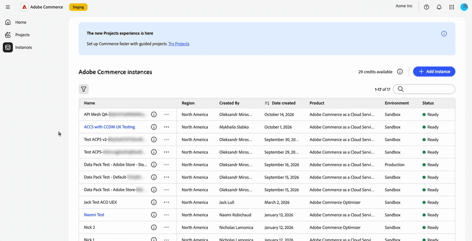
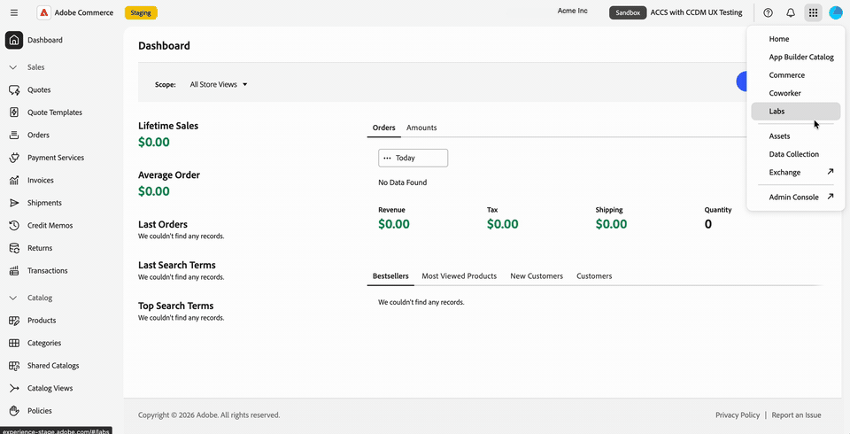

# Adobe Unified ExperienceのCommerce管理者

Commerce Cloud Managerでインスタンス名を選択すると、Adobe Commerce as a Cloud ServiceのCommerce管理者がAdobe Unified Experienceで開きます。

Adobeの統合エクスペリエンスインターフェイスは、Adobe製品全体で使用される共有トップナビゲーション、更新された左ナビゲーション、更新された管理者ページのスタイルを提供します。

組織、製品、Commerce インスタンスを切り替え、上部のナビゲーションからヘルプ、通知、アカウント設定にアクセスできます。 既存のCommerce ロールの権限によって、引き続きアクセスできる管理者メニュー項目が決まります。

>[!NOTE]
>
>Adobe Unified ExperienceのCommerce管理者は、Adobe Commerce as a Cloud Serviceでのみ使用できます。 Adobe Commerce on cloud infrastructureとAdobe Commerce オンプレミスのお客様は、引き続き[従来のCommerce管理UI](admin.md)を使用します。

{width="800" zoomable="yes" border="light"}

## Commerce Adminを開く

[Adobe Experience Cloud](https://experience.adobe.com/){target="_blank"}にログインしたら、Commerce Cloud Managerを開きます。 次に、インスタンスを選択して、統合エクスペリエンスで管理者を開きます。

ログインフローでは、各インスタンスに個別にログインしなくても、Commerce インスタンス間を移動できます。
Adobe製品とCommerce インスタンス間を切り替えるには、ログインプロンプトを使用する必要はありません。

アクセス手順については、_Adobe Commerce as a Cloud Service ガイド_&#x200B;の「[ インスタンスへのアクセス ](https://experienceleague.adobe.com/en/docs/commerce/cloud-service/getting-started#access-an-instance){target="_blank"}」を参照してください。

>[!BEGINTABS]

>[!TAB Commerce Cloud Managerから管理者を開く]

{width="800" zoomable="yes" border="light"}

>[!TAB 実際の操作]を見る

{width="800" zoomable="yes" border="light"}

>[!ENDTABS]

### 管理者インターフェイスの選択 {#classic-ui}

統合エクスペリエンスでのCommerce管理者の最初のリリースでは、Adobe Commerce as a Cloud Serviceは、Adobe Unified Experienceとクラシック UIの2つのCommerce管理エクスペリエンスをサポートしています。

デフォルトでは、Commerce Cloud ManagerでCommerce インスタンスを選択すると、Adobe Unified ExperienceでCommerce管理者が開きます。 クラシック UIに戻るには、既存のブックマークを使用するか、クラシック UIのURLを見つけます。 「[ クラシック UIを開く](#open-classic-ui)」を参照してください。

統合エクスペリエンスとクラシック UIのリンクは、Commerce Cloud Managerのインスタンスの詳細パネルで使用できます。

| リンク | エクスペリエンス |
| --- | --- |
| **[!UICONTROL Admin URL (Unified Shell UI)]** | 統合エクスペリエンスで管理者を開きます。 |
| **[!UICONTROL Admin URL (Classic UI)]** | 前の管理者インターフェイスを開きます。 |

{width="800" zoomable="yes" border="light"}

_インスタンスリストのスクリーンショットと、更新されたインスタンスの詳細デザインに基づくイラストレーション。 表示されたURLは、ステージング ホストを使用しています。_

#### URL形式

| エクスペリエンス | URL パターン |
| --- | --- |
| 統合された顧客体験 | `https://<experience-cloud-host>/#/@<organization>/in:<instance-id>/commerce/cloud-service/admin` |
| クラシック UI | `https://<commerce-admin-host>/<instance-id>/admin/` |

統合エクスペリエンスは、`@`以降の組織と`in:`以降のインスタンスを識別します。 クラシック UIは、インスタンス IDをホスト名の直後に配置します。

例えば、これらのステージング URLは同じインスタンスを開きます。

- **統合エクスペリエンス**: `https://experience-stage.adobe.com/#/@adobe-commerce-uex/in:<instance-id>/commerce/cloud-service/admin`
- **クラシック UI**: `https://na1-stage.admin.commerce.adobe.com/<instance-id>/admin/`

これらのステージングホスト名は実稼動URLではありません。 URLを作成する代わりに、常にCommerce Cloud Managerのインスタンスリンクを使用します。

#### クラシック UIを開く

クラシック UIを開くには：

- 既存のクラシック管理ブックマークまたはURLを使用します。 これらのURLはクラシック UIのみを開き、統合エクスペリエンスにはリダイレクトしません。
- Commerce Cloud Manager インスタンスの詳細で「**[!UICONTROL Admin URL (Classic UI)]**」を選択します。

管理者内にインターフェイススイッチはありません。 Commerce Cloud Managerまたは保存された管理者URLを使用して、必要に応じてクラシックインターフェイスに戻ります。

## 組織とインスタンスの特定

変更を行う前に、作業中の組織とインスタンスを確認します。

- アカウントメニューに現在の組織が表示されます。
- 上部のナビゲーションのインスタンス切り替え機能には、インスタンス名と&#x200B;**[!UICONTROL Production]**&#x200B;または&#x200B;**[!UICONTROL Sandbox]** バッジが表示されます。

環境バッジを使用して、インスタンスを切り替える際に実稼動インスタンスとサンドボックスを区別します。

## 組織、製品、インスタンスの切り替え

上部のナビゲーションには、作業コンテキストを切り替えるための個別のコントロールが用意されています。

### 組織の切り替え

上部ナビゲーションの組織スイッチャーを使用して、アクセス権のある組織の間を移動します。

1. 上部のナビゲーションで、組織名を選択します。

1. リストから組織を選択します。

   このリストには、アクセスできる組織が表示されます。 チェックマークは、作業中の組織を示します。

>[!BEGINTABS]

>[!TAB 組織スイッチャー]

{width="800" zoomable="yes" border="light"}

>[!TAB 実際の操作]を見る

{width="800" zoomable="yes" border="light"}

>[!ENDTABS]

アカウントメニューには、作業中の組織も表示されます。 上部ナビゲーションでプロファイル画像（{width="24"}）を選択し、**[!UICONTROL Organization]**&#x200B;行を確認します。

現在の組織を表示する{width="800" zoomable="yes" border="light"}

開くことができるインスタンスは、作業中の組織に属しています。 インスタンスを変更するには、[Commerce インスタンスの切り替え](#switch-commerce-instances)を参照してください。

### 製品を切り替える

上部ナビゲーションの製品スイッチャー（{width="24"}）を使用して、アプリケーションをいつでも変更できます。 他のAdobe製品と同じように機能します。

- **Admin Console**：製品スイッチャーからAdobe Admin Consoleを開いて、ユーザーとそのアクセスを管理します（**[!UICONTROL Administer]** > **[!UICONTROL Users]**）。 URLを覚えておく必要はありません。 Adobe Admin Consoleは、ストアを管理するCommerce管理者とは別のものです。
- **Adobe Exchange**: Adobe Creative Cloud、Adobe Experience Cloud、Adobe Document Cloudのサードパーティ製の拡張機能、プラグイン、スクリプト、エンタープライズ統合を見つけます。
- **その他の製品**: Coworkerなどの製品を開きます。

>[!BEGINTABS]

>[!TAB 製品スイッチャーメニュー]

{width="800" zoomable="yes" border="light"}

>[!TAB 実際の操作]を見る

{width="800" zoomable="yes" border="light"}

>[!ENDTABS]

Adobe Commerce as a Cloud Serviceのユーザーおよびロール管理については、[ ユーザー管理](https://experienceleague.adobe.com/en/docs/commerce/cloud-service/user-management){target="_blank"}を参照してください。

### Commerce インスタンスの切り替え

上部ナビゲーションには、インスタンス切り替えボタンが含まれています。 常に&#x200B;**[!UICONTROL Production]**&#x200B;または&#x200B;**[!UICONTROL Sandbox]**&#x200B;のバッジと、使用中のインスタンスの名前が表示されます。

1. 上部のナビゲーションで、現在のインスタンス名と環境バッジを表示するインスタンススイッチャーを選択します。

1. リストからインスタンスを選択します。

   このリストには、現在の組織でアクセスできるAdobe Commerce as a Cloud Service インスタンスが含まれています。 Commerce Cloud Managerに戻ってインスタンスを切り替える必要がないため、インスタンス間を行ったり来たりすることができます。

1. 作業を続行する前に、インスタンス名と環境バッジを確認してください。

インスタンスはページ URLの一部であるため、特定のインスタンスを開くリンクをブックマークまたは共有できます。 リンクにインスタンスを含めずに管理者を開くと、最後に使用したインスタンスが読み込まれます。

## 左側のナビゲーションの使用

Commerce管理メニューは、Adobe統合エクスペリエンスの左側のナビゲーションに表示されます。 メニューセクションを展開または折りたたんで必要なツールを見つけるか、または入力してメニュー項目に移動します。

メニューは、作業中のインスタンスに固有です。 インスタンスを切り替えると、左側のナビゲーションが一致するように更新されます。

既存の役割の権限は引き継がれます。 役割で許可されているメニュー項目のみが表示されます。

製品、注文、顧客、設定の管理などのタスクには、引き続き管理ガイドを使用します。 管理者ページのスタイルが更新されたので、その外観はクラシック UIのスクリーンショットとは異なる場合があります。

>[!BEGINTABS]

>[!TAB Commerce管理者はナビゲーションを終了しました]

{width="800" zoomable="yes" border="light"}

>[!TAB 実際の操作]を見る

{width="800" zoomable="yes" border="light"}

>[!ENDTABS]

## ヘルプを表示してフィードバックを提供する

Commerce管理者から離れずにリソースにアクセスするには、上部ナビゲーションのヘルプアイコン（{width="24"}）を使用してヘルプパネルを開きます。

- **ヘルプ**: パネルから直接Adobe Experience Leagueでドキュメントを検索します。
- **サポート**: コミュニティフォーラムやその他の学習リソースにアクセスし、Adobe Experience Leagueでサポートチケットを検索します。
- **フィードバック**：同じパネルからAdobeにフィードバックを送信します。

ヘルプ、サポート、フィードバックはコンテキストで利用できます。 あなたはCommerce管理者に留まり、自分の場所を失うことはありません。

>[!BEGINTABS]

>[!TAB  ヘルプパネル ]

{width="800" zoomable="yes" border="light"}

>[!TAB 実際の操作]を見る

{width="800" zoomable="yes" border="light"}

>[!ENDTABS]

## 通知の表示 {#view-notifications}

通知、リクエスト、製品のお知らせをコンテキストで表示するには、上部ナビゲーションのベルアイコン（{width="24"}）を使用して通知パネルを開きます。

パネルを使用すると、**[!UICONTROL Requests]**、**[!UICONTROL Notifications]**、**[!UICONTROL Announcements]**&#x200B;が1か所にまとめられます。 Commerce管理者を離れなくても、表示されます。

Commerce ページヘッダー内の通知コントロールではなく、このパネルの統合エクスペリエンスの上部ナビゲーションにあるベルアイコンを使用します。 Commerce管理者の受信トレイ メッセージについて詳しくは、[ メッセージの受信トレイ ](admin-message-inbox.md)を参照してください。

>[!BEGINTABS]

>[!TAB 通知パネル ]

{width="800" zoomable="yes" border="light"}

>[!TAB 実際の操作]を見る

{width="800" zoomable="yes" border="light"}

>[!ENDTABS]

## アカウント環境設定の管理

上部のナビゲーションでプロファイル画像（{width="24"}）を選択して、アカウントメニューを開きます。 このメニューから、次のことができます。

- 作業中の組織を表示します。
- **[!UICONTROL Dark theme]** トグルでダークモードを有効にします。
- ユーザー設定を開きます。

>[!BEGINTABS]

>ダークモードの[!TAB  アカウントメニュー]

ダークモードの{width="800" zoomable="yes" border="light"}

>[!TAB 実際の操作]を見る

ダークモードの{width="800" zoomable="yes" border="light"}

>[!ENDTABS]

## 更新されたページのスタイル

Commerce管理画面のページは、Adobe Unified Experienceに一致するリフレッシュされた外観になります。 後のリリースでは、さらに多くのスタイル変更が予定されています。

>[!MORELIKETHIS]
>
>[Adobe CX Enterprise インターフェイスおよび管理ガイド ](https://experienceleague.adobe.com/en/docs/core-services/interface/experience-cloud)
