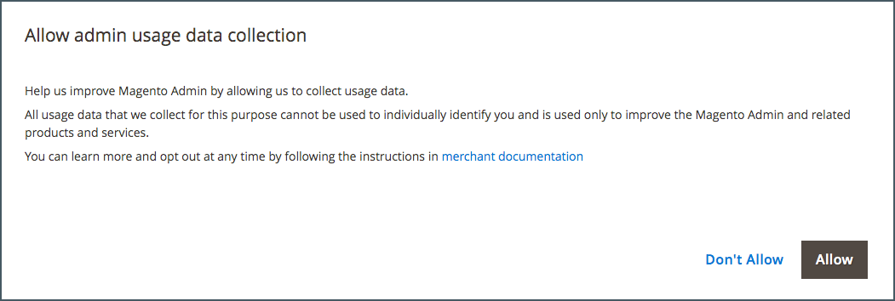

# 管理者とは

ストア _管理者_&#x200B;は、パスワードで保護されたバックオフィスです。ここでは、販売者として、製品とプロモーションの設定、注文の管理、その他の管理タスクを行います。 すべての基本的な設定タスクとストア管理操作は、_管理者_&#x200B;から実行されます。

{{$include /help/_includes/admin-unified-experience-note.md}}

セキュリティを強化するため、_管理者_&#x200B;のログインは[二段階認証](../systems/security-two-factor-authentication.md)によって保護され、[CAPTCHA](../systems/security-captcha.md)を必要とするように設定できます。 詳しくは、[管理者セキュリティの設定](../systems/security-admin.md)にアクセスしてください。

{width="700" zoomable="yes"}

最初の[&#x200B; ログイン &#x200B;](admin-signin.md)資格情報は、Adobe CommerceまたはMagento Open Sourceのインストール中に設定されました。 パスワードを忘れた場合は、アカウントに関連付けられているメールアドレスに一時的なパスワードを送信できます。 セキュリティを強化するには、大文字と小文字を区別するユーザー名と強力なパスワードを必要とするようにストアを設定します。

デフォルトの管理者ユーザーアカウントに加えて、ストアの管理とカスタマーアカウントのサポートに必要な追加アカウントを[個](../systems/permissions-users-all.md)作成できます。 各アカウントは、ビジネス _の必要な知識_&#x200B;に基づいて、特定の[役割](../systems/permissions-user-roles.md)およびアクセスレベルに関連付けることができます。 各管理者ユーザーアカウントに関連付けられている電子メールアドレスは、一意である必要があります。

{{ims-admin-note}}

## 利用状況データの収集

_管理者_&#x200B;に初めてログインする場合は、すべての管理者ユーザーの使用状況データを収集するためのAdobe権限を付与するように求められます。 管理者の使用状況データの収集を許可することで、AdobeでAdobe Commerce管理者および関連製品やサービスの使用体験を向上させることができます。

{width="600"}

使用状況データでは、個々のユーザーは識別されません。 ユーザーのデータ収集設定は、[管理者使用状況](../configuration-reference/advanced/admin.md#admin-usage)設定からいつでも変更できます。

Adobe Commerceの場合、データ収集を許可すると、_製品内ガイダンス_&#x200B;も有効になります。このガイダンスは、_管理者_&#x200B;にインタラクティブコンテンツを提供するように設計されています。 ヘルプ、ツールのヒント、チュートリアル ガイド、オンボーディング情報、機能のお知らせなどを提供します。
