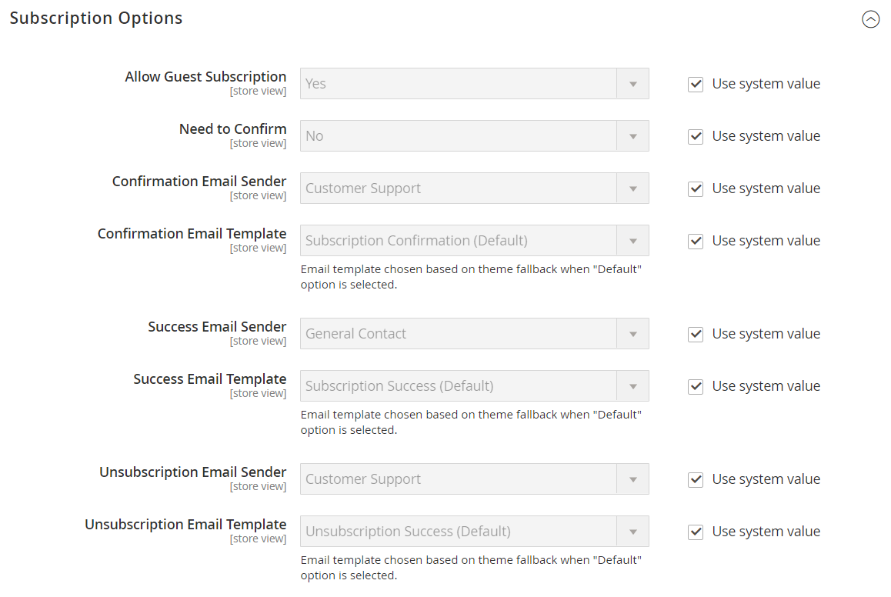

# ニュースレターと購読

定期的なニュースレターの公開は、利用可能な最も強力で手頃なマーケティングツールのひとつであると考えられています。 Commerceなら、購読している顧客にニュースレターを配信します。さらに、ニュースレターの作成、購読者リストの作成と管理、コンテンツの制作、ストアへのトラフィックの増加を実現するツールも利用できます。 また、[ ページ階層](../content-design/page-hierarchy.md)を使用して、過去の問題のアーカイブを作成することもできます。

>[!NOTE]
>
>Commerce インスタンスをサードパーティのニュースレターサービスプロバイダーと統合し、拡張機能を追加することで、機能を追加できます。 詳しくは、[Commerce Marketplace](../getting-started/commerce-marketplace.md)を参照してください。

ニュースレターを作成する最初の手順は、サイトのニュースレター設定を設定することです。 電子メールで送信された確認リンクをクリックして、サブスクリプションを確認するように顧客に要求できます。 このダブルオプトイン方式では、顧客がニュースレターを受け取ることを2回確認する必要があり、迷惑メールとみなされる可能性を低減します。

## ニュースレターの有効化

1. _管理者_ サイドバーで、**[!UICONTROL Stores]** > _[!UICONTROL Settings]_>**[!UICONTROL Configuration]**に移動します。

1. 左側のパネルで、**[!UICONTROL Customers]**&#x200B;を展開し、**[!UICONTROL Newsletter]**&#x200B;を選択します。

1. **[!UICONTROL General Options]** セクションのを展開します。

1. ストアビューの範囲でニュースレターを有効にするには、**[!UICONTROL Enabled]**&#x200B;を`Yes`に設定します。

ニュースレター機能を有効にすると、_[!UICONTROL Subscription Options]_セクションが表示されます。

## サブスクリプションオプションの設定

1. _管理者_ サイドバーで、**[!UICONTROL Stores]** > _[!UICONTROL Settings]_>**[!UICONTROL Configuration]**に移動します。

1. 左側のパネルで、**[!UICONTROL Customers]**&#x200B;を展開し、**[!UICONTROL Newsletter]**&#x200B;を選択します。

1. 必要に応じて、[設定スコープ ](../getting-started/websites-stores-views.md#scope-settings)を変更して、特定のサイト/ストアビューにニュースレター設定の変更を適用します。

1. **[!UICONTROL Subscription Options]** セクションのを展開し、次の操作を行います。

   {width="600" zoomable="yes"}

   - 購読者に送信される次の各メールメッセージのメールテンプレートと送信者を確認します。

     - [!UICONTROL Success email]
     - [!UICONTROL Confirmation email]
     - [!UICONTROL Unsubscribe email]

   - ダブルオプトインプロセスを使用してサブスクリプションを確認するには、**[!UICONTROL Need to Confirm]**&#x200B;を`Yes`に設定します。

   - ストアのアカウントを持たないユーザーにニュースレターの購読を許可するには、**[!UICONTROL Allow Guest Subscription]**&#x200B;を`Yes`に設定します。

1. 完了したら、**[!UICONTROL Save Config]**&#x200B;をクリックします。
