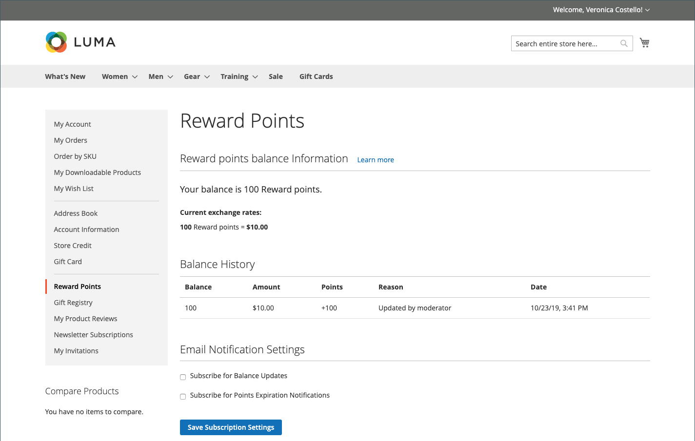

# ポイントストアフロント体験への報酬

{{ee-feature}}

顧客アカウントの[報酬ポイント &#x200B;](rewards-loyalty.md) セクションには、顧客が獲得した報酬ポイントの現在の残高と、その報酬ポイント残高の履歴が表示されます。

{width="700" zoomable="yes"}

## チェックアウト時に報酬ポイントを交換する

`Points to Currency`方向の[&#x200B; ポイント換算レート &#x200B;](reward-exchange-rates.md)が設定されている場合、お客様はチェックアウト時にポイントを使用できます。

1. 顧客は、必要な商品をすべてショッピングカートに入れた後、チェックアウトに移動します。

1. 必要なすべての出荷情報を入力し、_確認と支払い_ ステップに移動します。

1. 「_[!UICONTROL Reward points]_」セクションで、利用可能なポイント数とその通貨値を確認します。

1. **[!UICONTROL Use reward points]**&#x200B;をクリックします。

{width="700" zoomable="yes"}

利用可能なポイントの割引は、小計に適用されます。

>[!NOTE]
>
>ご利用いただける残高が注文の合計金額を超える場合は、別のお支払い方法は必要ありません。
