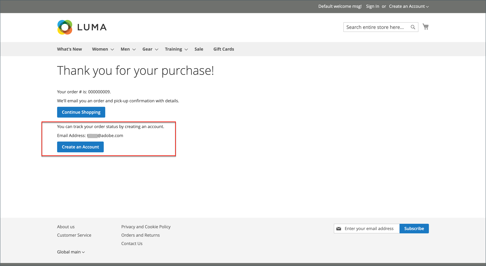
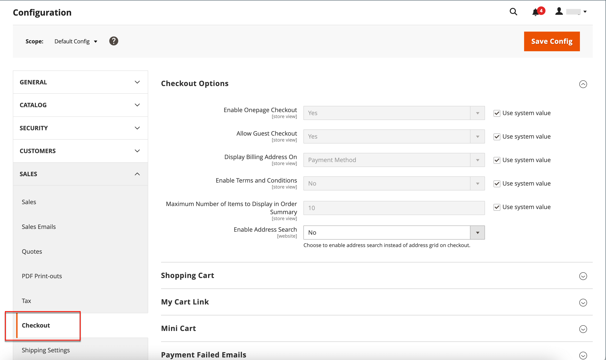

# ゲストチェックアウト

ストアは、買い物客が購入する前にアカウントを開くように設定できます。 デフォルト設定では、チェックアウトプロセスを完了した後にアカウントに登録するオプションを使用して、ゲストが購入できます。

{width="600" zoomable="yes"}

**_ゲストチェックアウトを無効にするには:_**

1. _管理者_ サイドバーで、**[!UICONTROL Stores]** > **[!UICONTROL Configuration]**&#x200B;に移動します。

1. 左側のパネルで、**[!UICONTROL Sales]**&#x200B;を展開し、**[!UICONTROL Checkout]**&#x200B;を選択します。

1. **[!UICONTROL Checkout Options]** セクションのを展開します。

   {width="700" zoomable="yes"}

これらの各構成設定の詳細については、_構成リファレンスガイド_&#x200B;の[&#x200B; チェックアウトオプション &#x200B;](../configuration-reference/sales/checkout.md#checkout-options)を参照してください。

1. 設定が特定のストアビューの場合、[設定が適用されるストアビュー](../configuration-reference/scope-change.md#set-the-scope)を選択します。

   プロンプトが表示されたら、**[!UICONTROL OK]**&#x200B;をクリックして続行します。

1. **[!UICONTROL Allow Guest Checkout]**&#x200B;を`No`に設定します。

   必要に応じて、**[!UICONTROL Use system value]** チェックボックスをオフにして、この設定の変更を有効にします。

1. **[!UICONTROL Save Config]**&#x200B;をクリックします。

## 登録済み電子メールに対するゲスト注文のアクセスを許可

[!BADGE SaaSのみ]{type=Positive url="https://experienceleague.adobe.com/en/docs/commerce/user-guides/product-solutions" tooltip="Adobe Commerce as a Cloud Service プロジェクト（Adobeで管理されるSaaS インフラストラクチャ）にのみ適用されます。"}

オプションのストアレベル設定は、デフォルトで無効になっていますが、ゲストの買い物客は、登録済みの顧客アカウントに一致するメールアドレスを使用して、注文した注文を追跡できます。

有効にすると、登録済みの電子メールで行われたゲストチェックアウトの注文にアクセスできるようになりますが、顧客の注文履歴にも表示されます。

この機能を有効にするには、**[!UICONTROL Stores]** > **[!UICONTROL Configuration]** > **[!UICONTROL Sales]** > **[!UICONTROL Sales]** > **[!UICONTROL Guest Checkout]**&#x200B;に移動し、**[!UICONTROL Allow Guest Order Access for Registered Emails]**&#x200B;設定を`Yes`に設定します。
