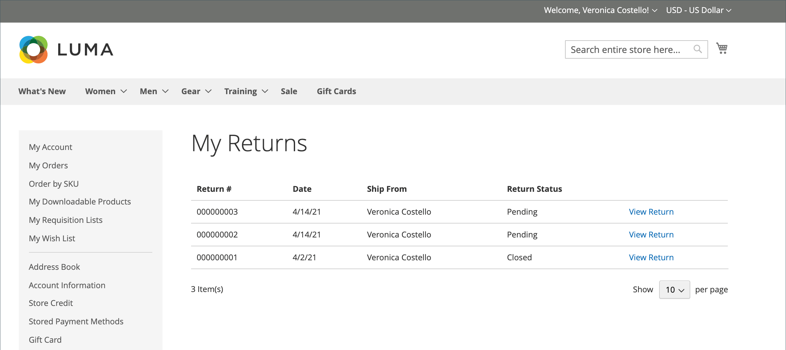
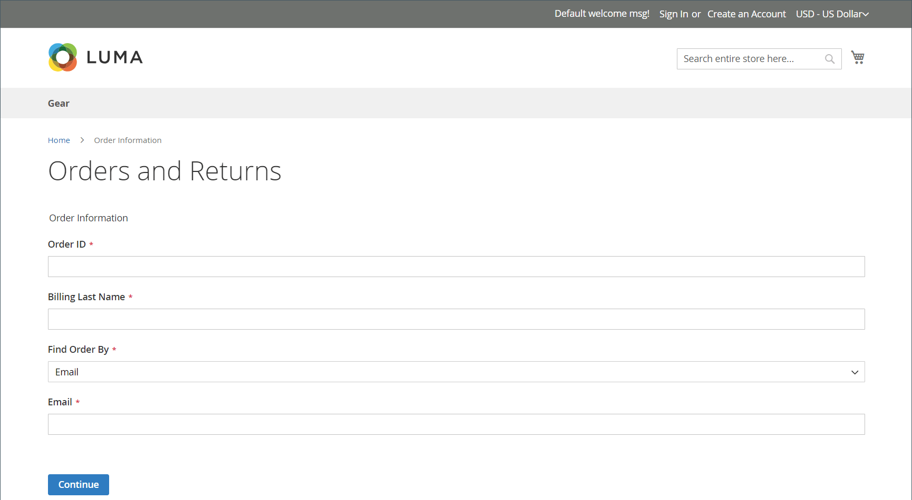
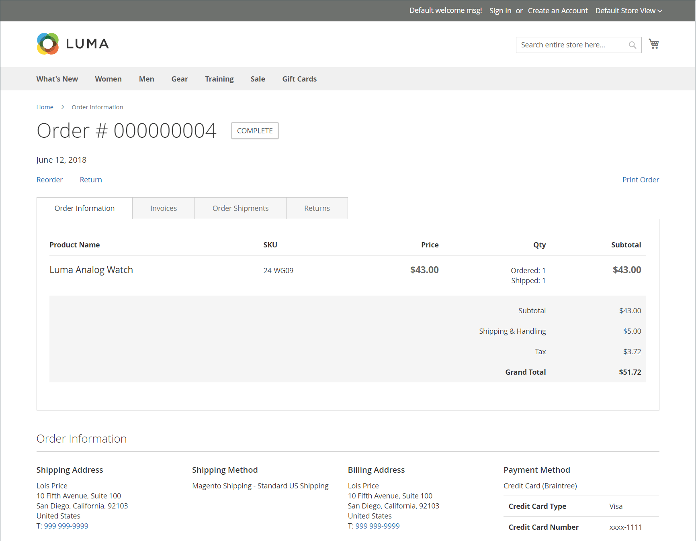
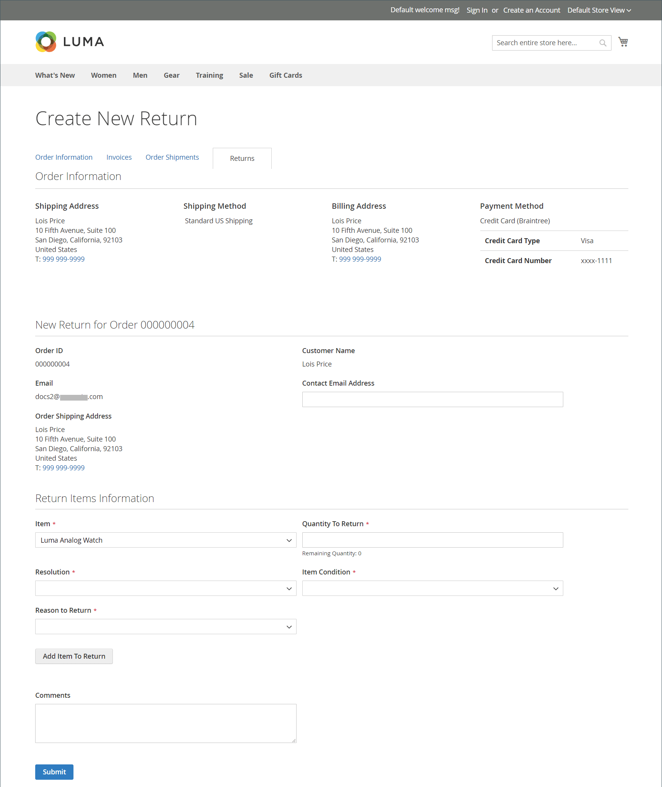

# ストアフロント体験を返す

{{ee-feature}}

顧客は、次のいずれかを使用して、ストアフロントからRMAをリクエストできます。

- サイドバーの[注文と返品ウィジェット &#x200B;](../content-design/widget-orders-returns.md)
- フッターの&#x200B;_注文と返品_ リンク

ベストプラクティスとして、カスタマーサービスポリシーに、RMAの要件とプロセスの説明を必ず含めてください。

>[!NOTE]
>
>返品に関連する追加情報を収集する場合は、独自のカスタム [返品属性](attributes-returns.md)を追加できます。

すべての顧客RMA情報は、顧客アカウントダッシュボードの&#x200B;**[!UICONTROL My Returns]** ページに表示されます。

{width="700" zoomable="yes"}

## RMAの導入を検討

お客様は、ストアフロントで次の手順を実行してRMAを送信します。

1. フッターで、**[!UICONTROL Orders and Returns]**&#x200B;をクリックします。

1. 注文情報を入力します。

   - 注文ID
   - 請求先姓
   - メール

1. **[!UICONTROL Continue]**&#x200B;をクリックします。

   {width="700" zoomable="yes"}

1. 注文日の下で、**[!UICONTROL Return]**&#x200B;をクリックします。

   {width="700" zoomable="yes"}

1. 返す項目を選択し、**[!UICONTROL Quantity to Return]**&#x200B;を入力します。

1. **[!UICONTROL Resolution]**&#x200B;を次のいずれかに設定します。

   - Exchange
   - [返金](../customers/refunds-customer-account.md)
   - [ストアクレジット](../customers/store-credit-using.md)

1. **[!UICONTROL Item Condition]**&#x200B;を次のいずれかに設定します。

   - `Unopened`
   - `Opened`
   - `Damaged`

1. **[!UICONTROL Reason to Return]**&#x200B;を次のいずれかに設定します。

   - `Wrong Color`
   - `Wrong Size`
   - `Out of Service`
   - `Other`

   {width="700" zoomable="yes"}を作成

1. 必要に応じて、**[!UICONTROL Contact Email Address]**&#x200B;と&#x200B;**[!UICONTROL Comments]**&#x200B;を設定します。

   >[!NOTE]
   >
   >注文に複数の項目が含まれており、顧客が別の項目を返す場合は、**[!UICONTROL Add Item To Return]**&#x200B;をクリックし、項目を選択してから、すべてのオプションを設定できます。

1. **[!UICONTROL Submit]**&#x200B;をクリックします。
